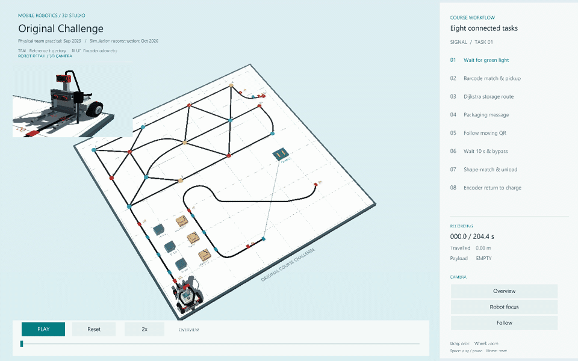

# Mobile Robotics in Intralogistics

A Python simulation reconstruction of the eight-task Challenge from a TUM team robotics practical. It combines differential-drive motion, encoder odometry, Dijkstra routing and P/PI control with synthetic observations and desktop visualization.

The team hardware practical was completed in September 2025. This repository contains a new simulation reconstruction written in October 2026; the original coursework implementation is not included.



[Watch the 3D demo](docs/media/studio-preview.mp4) · [View the track layout](docs/media/original-challenge-topdown.png)

## Environment and run

Use Python 3.10+ with Tkinter. The lightweight viewer uses Pillow; the optional 3D Studio adds Panda3D 1.10.16 and requires an OpenGL-capable desktop display. The program runs offline without robot hardware or ROS.

Clone the repository, then install and run from its folder, preferably in a virtual environment:

```bash
git clone https://github.com/Gklsa/mobile-robotics-intralogistics.git
cd mobile-robotics-intralogistics
python -m pip install -r requirements-3d.txt
python main.py --studio
```

For the lightweight analysis window:

```bash
python -m pip install -r requirements.txt
python main.py
```

Both viewers open the bundled simulation recording. The 3D Studio supports orbit, zoom, a follow camera and a robot close-up. Videos and images under `docs/media/` can be viewed without installing Python.

## How it works

The task sequence covers a traffic-light start, barcode pickup, warehouse routing, worker handover, QR following, obstacle waiting and bypass, packing, and return to the charger.

```text
Editable track and task configuration
  -> task sequencing, routing and control
  -> differential-drive simulation and encoder odometry
  -> JSON recording
  -> desktop playback, plots and exported media
```

Camera observations, worker messages and task triggers are synthetic. Obstacle bypass uses known geometric boundaries, and the map's metric scale is an editable assumption. Reported metrics describe the reconstructed simulation.

## Repository structure

| Path | Purpose |
|---|---|
| `main.py` | Entry point, viewer selection and regeneration |
| `native_3d.py` / `native_view.py` | Panda3D Studio and lightweight analysis viewer |
| `config/original_map.json` | Track topology, geometry and task locations |
| `src/intralogistics_sim/` | Task logic, planning, motion, odometry and optional mapping lab |
| `docs/data/original-challenge.json` | Bundled simulation recording |
| `docs/media/` | Demo videos and images |
| `tools/` / `tests/` | Recording generation, optional labs, exports and automated checks |

## Recompute or check

Regenerate the recording with a storage destination of `g`, `i`, `k` or `l`:

```bash
python main.py --studio --regenerate --storage i
```

Run the automated checks and the lightweight renderer/data check:

```bash
python -m unittest discover -s tests -v
python main.py --smoke-test
```

Tests cover routing, motion, task ordering, obstacle waits, clearance and odometry continuity. Optional synthetic labs for occupancy-grid mapping, BUG2 and line following are available through `python tools/run_labs.py --help`; their outputs go to `outputs/`.

The original hardware work was a team course project. The present simulation and generated visualizations are a later reconstruction of that course scenario; its synthetic observations and local message bus do not establish camera or MQTT hardware performance.
